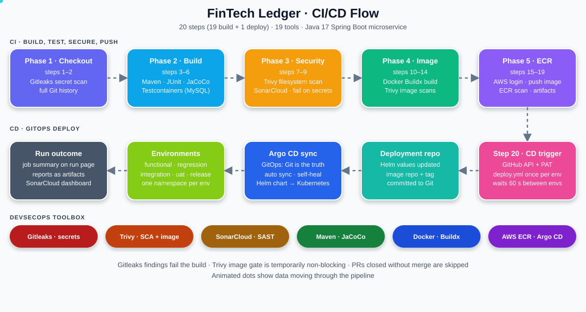
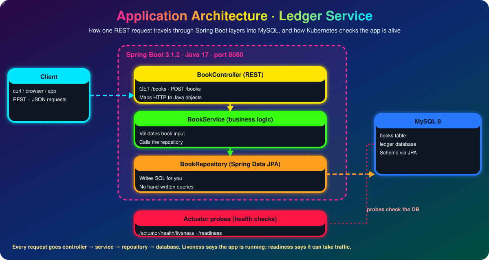
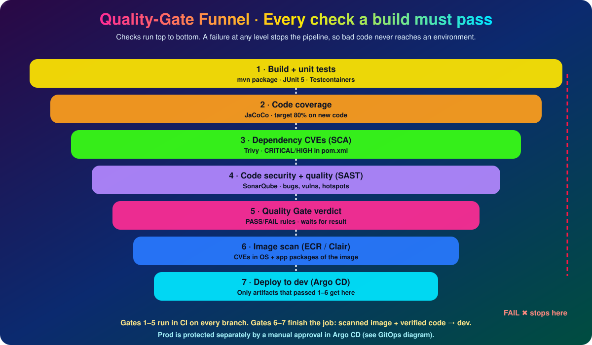
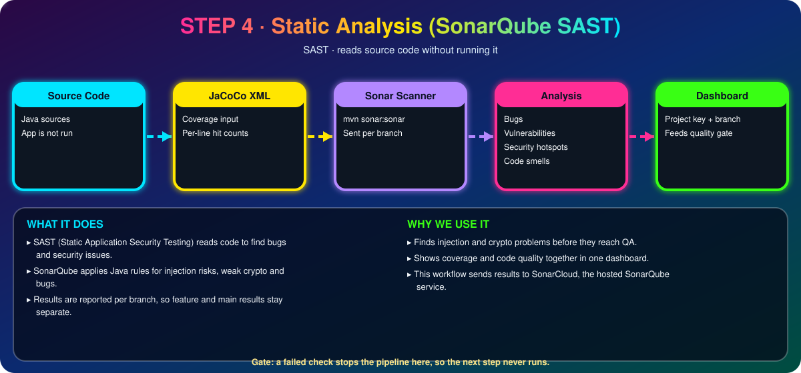
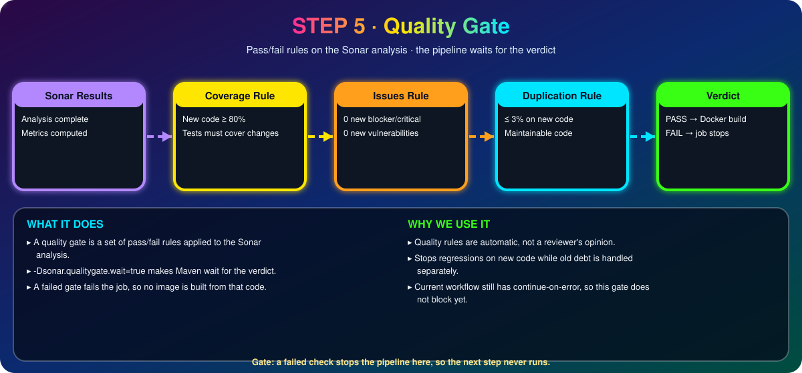
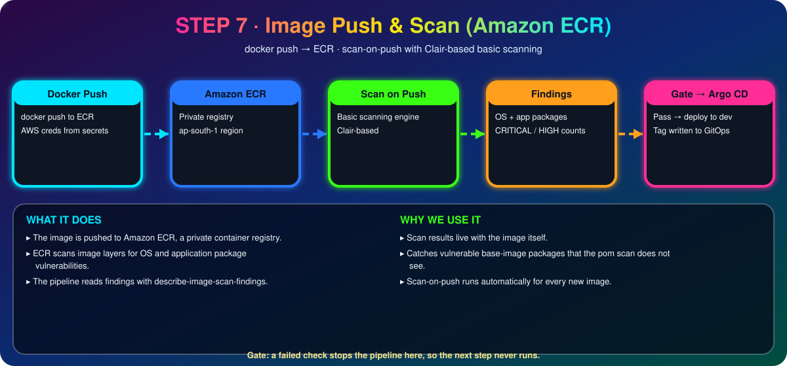
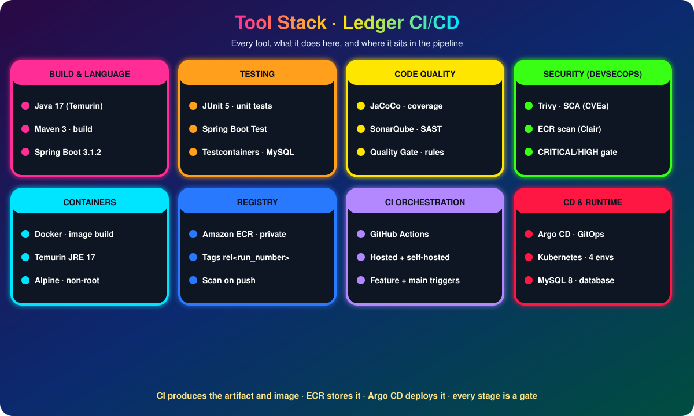
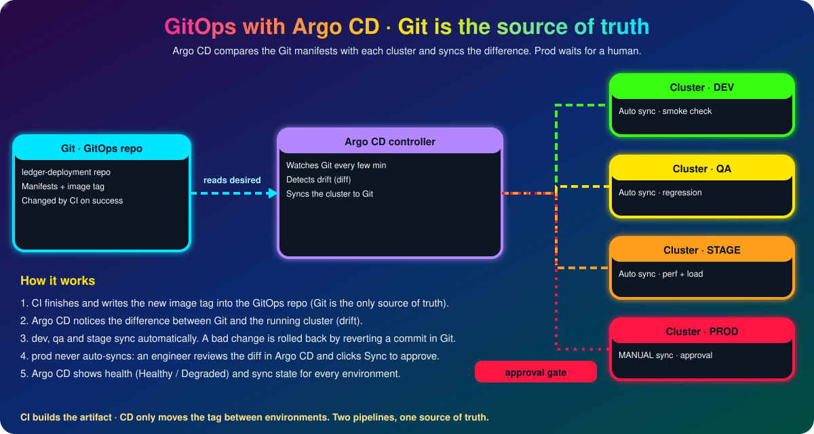

# Ledger Microservice · CI/CD with Trunk-Based Development

> **Programming language: Java (Spring Boot).** This is a **Java Spring Boot Microservice**.

> A **Java 17 · Spring Boot 3.1.2 · MySQL** ledger (books) microservice built with **Maven**, delivered through **GitHub Actions** (CI) and **Argo CD** (CD) across **dev → qa → stage → prod**.

## 🎤 Interview Guide: The Full DevSecOps Flow

This section explains the whole pipeline in plain words. Read it before an interview.

**What the application is:** the Ledger service is a **Java Spring Boot microservice**. It is a REST API for books and ledger entries, written in Java, built with **Maven**, and packaged as a Spring Boot JAR. The project targets **Java 17** (`pom.xml`). The CI workflow builds with **JDK 21**, which compiles Java 17 code without problems.



### 🔁 When the pipeline runs

| Event | What happens |
|---|---|
| Push to `feature` | Full CI runs, builds a `fb-` image, and deploys to **functional** |
| Pull request opened, updated or reopened (to `main` or `feature`) | Full CI runs, builds a `fb-` image |
| Pull request **merged** from `feature` into `main` | Full CI runs, builds a `rel-` image, and deploys to **regression** and **integration** |
| Pull request **closed without merge** | CI is skipped |
| Manual run (`workflow_dispatch`) | Builds from the chosen branch and deploys to the environment you pick |

### 🧩 Step by step

| # | Step | What it does | Tool | Why it matters |
|---|---|---|---|---|
| 1 | **Checkout** | Downloads the full Git history (`fetch-depth: 0`) | `actions/checkout` | Gitleaks and SonarCloud need the full history |
| 2 | **Secret scan** | Looks for passwords, tokens and keys in the files of the repo. Writes a SARIF report | **Gitleaks** | Stops secrets from reaching `main` |
| 3 | **Set up Java** | Installs JDK 21 and caches Maven downloads | `actions/setup-java` | Same Java toolchain on every run |
| 4 | **Build and test** | `mvn clean verify`: compiles, runs unit tests and integration tests, packages the JAR | **Maven**, **JUnit 5**, **Testcontainers** | Broken code fails here, before any image is built |
| 5 | **Coverage report** | Measures how much code the tests cover and uploads the HTML report | **JaCoCo** | Shows which code is not tested |
| 6 | **Dependency scan (SCA)** | Checks `pom.xml` libraries for known CVEs. Writes JSON and SARIF | **Trivy** (filesystem mode) | Finds vulnerable third-party libraries |
| 7 | **Code scan (SAST) and quality gate** | Analyses the source code for bugs and security issues. Sends the Gitleaks and Trivy reports too. Waits for the quality gate result | **SonarCloud** | Finds insecure code patterns and enforces quality rules |
| 8 | **Fail on secrets** | If Gitleaks found anything, the job fails. This runs after SonarCloud, so findings still reach the dashboard | Shell (`exit 1`) | Enforces the "no secrets" rule |
| 9 | **Decide image tag** | Builds the tag from the event, run number and short commit ID, for example `fb-42-a1b2c3d4` or `rel-43-e5f6a7b8` | Shell | Each image can be traced back to one run and one commit |
| 10 | **Build image** | Builds the Docker image locally (not pushed yet) | **Docker Buildx**, `docker/build-push-action` | Scan the image before it leaves the runner |
| 11 | **Image scan (full report)** | Scans the image for OS and library vulnerabilities and saves a JSON report. Never blocks | **Trivy** (image mode) | Gives a complete list for review |
| 12 | **Image scan (gate)** | Fails on fixable CRITICAL vulnerabilities. **Temporarily non-blocking** until the base image and Spring Boot are upgraded | **Trivy** | Stops known critical flaws from shipping |
| 13 | **AWS login** | Logs in to AWS with access keys and then to Amazon ECR | `aws-actions/configure-aws-credentials`, `amazon-ecr-login` | The image can be pushed to the private registry |
| 14 | **Push to ECR** | Pushes the image to the Amazon ECR repository | **Amazon ECR**, Docker | The image becomes available to Kubernetes |
| 15 | **ECR scan report** | Waits for ECR's scan-on-push result. Saves the digest, size, push time and findings. Writes a summary on the run page | **AWS CLI**, **jq**, **ECR scan** | A second, independent vulnerability scan |
| 16 | **Upload reports** | Saves every report (even if an earlier step failed) as a downloadable artifact | `actions/upload-artifact` | Auditors and reviewers can read the evidence |
| 17 | **Trigger CD** | Calls the GitHub API to start `deploy.yml` in the deployment repo once per environment. Waits 60 seconds between environments | **GitHub API**, **PAT** (`GH_PAT`), `curl` | Separates build (CI) from deploy (CD) |
| 18 | **Update values** | The deployment repo writes the new image repo and tag into `envs/<env>/values.yaml`, then commits and pushes | **Helm** values, Git | Git records exactly what was deployed |
| 19 | **Argo CD sync** | Argo CD sees the new commit, compares it with the cluster and applies the change. It auto-syncs and self-heals | **Argo CD** (GitOps) | Git is the single source of truth. No manual `kubectl` |

### 🛡️ DevSecOps tools and what they protect

| Tool | Category | What it catches | Where it runs |
|---|---|---|---|
| **Gitleaks** | Secret scanning | Passwords, API keys, tokens in the repo files | Step 2 |
| **Maven + JUnit 5 + Testcontainers** | Build and test | Functional bugs, and database tests in real containers | Step 4 |
| **JaCoCo** | Code coverage | Untested code | Step 5 |
| **Trivy (filesystem)** | SCA (dependency scan) | Known CVEs in libraries from `pom.xml` | Step 6 |
| **SonarCloud** | SAST and quality gate | Bugs, security hotspots, code smells, coverage thresholds | Step 7 |
| **Docker Buildx** | Image build | A reproducible container image | Step 10 |
| **Trivy (image)** | Container scan | OS and library CVEs inside the image | Steps 11 and 12 |
| **Amazon ECR** | Registry and scan on push | Private image storage and an extra vulnerability scan | Steps 14 and 15 |
| **GitHub Actions** | CI orchestration | Runs every step in order, with gates and artifacts | Whole pipeline |
| **GitHub PAT** | Cross-repo access | Lets the CI repo trigger the CD repo | Step 17 |
| **Argo CD** | GitOps CD | Keeps the cluster in line with Git. Auto-sync and self-heal | Step 19 |

### 🎯 Interview talking points

- **Shift left:** secrets, dependencies and code are checked **before** the image is built.
- **Build once, deploy many:** one image (`fb-` or `rel-` tag) is built once and promoted through environments. The image is not rebuilt for each one.
- **Traceability:** each tag includes the run number and short commit ID, and the image carries the commit SHA as a label.
- **Separation of CI and CD:** GitHub Actions builds and scans. Argo CD deploys from Git. The cluster never gets manual changes.
- **Defence in depth:** Gitleaks, Trivy (dependencies), SonarCloud (code), Trivy (image) and ECR scan-on-push each look at a different layer.
- **Honest gaps:** the Trivy image gate is temporarily non-blocking, and the workflow builds with JDK 21 while the project targets Java 17. Both are known and listed for follow-up.

## 🗺️ Pipeline at a Glance


## 🌿 Why Trunk-Based Development?

We use **trunk-based development**: `main` is the single trunk, and every change reaches it through a **short-lived feature branch**.

- **Small, frequent merges.** Branches live for hours or a few days, not weeks, so merge conflicts stay small.
- **Always releasable trunk.** `main` holds only code that has passed CI, so any commit can become a release.
- **Fast feedback.** Each push runs the full CI pipeline, so bugs surface minutes after they are written.
- **Promote code, not artifacts.** Only code moves to `main`. Each branch builds its own artifact: the feature build goes to dev, and the artifact built on `main` after the merge goes to qa, stage and prod.
- **Simpler than long-lived branches.** No `develop` or release branches to keep in sync.

## 🔀 Branch Flow in This Repo

1. Developer creates `feature/<name>` from `main`.
2. Developer pushes to the feature branch → **CI pipeline runs** (Steps 1–7 below).
3. CI passes → the image is deployed to **dev** with Argo CD.
4. **QA runs functional tests** on dev. If they pass, the feature is merged into `main` (trunk).
5. The merge to `main` runs CI again on the trunk: build, scan and image push (Steps 1–7 again).
6. The new image is deployed to **qa** for **regression testing**, then to **stage** for **performance and load testing**.
7. **Prod** is released only after a **manual approval** in Argo CD.

## ⚙️ CI vs CD: Two Separate Pipelines

| | **CI (GitHub Actions)** | **CD (Argo CD)** |
|---|---|---|
| **Goal** | Prove the code is good and build a trusted artifact | Deploy that artifact to an environment |
| **Triggers** | Push to a feature branch, or merge to `main` | Successful CI job, which triggers the CD pipeline for the matching environment |
| **Runs** | Maven build and tests, JaCoCo, Trivy, SonarQube, quality gate, Docker build, ECR push and scan | Syncs the Kubernetes manifests in the GitOps repo to the cluster for dev, qa, stage or prod |
| **Runners** | **Hybrid:** GitHub-hosted runners for standard build steps, and self-hosted runners where a job needs private network access | Argo CD running in the cluster |

## 🧱 Build Tool: Maven

This is a Java application, so **Maven** is the build tool. `pom.xml` defines Spring Boot 3.1.2, Java 17, JUnit 5, Spring Boot Test, Testcontainers (MySQL), the JaCoCo plugin and the Sonar plugin. Maven runs the lifecycle in order: `clean` → `compile` → `test` → `package`.

## 🏗️ Application Architecture

The Ledger service is a Spring Boot REST API backed by MySQL. Each request passes through three layers, and each layer has one job.



| Layer | Class | What it does |
|---|---|---|
| **Controller** | `BookController` | Receives HTTP calls such as `GET /books` and `POST /books`, and converts JSON to Java objects |
| **Service** | `BookService` | Holds the business logic and validates input before anything is saved |
| **Repository** | `BookRepository` | Spring Data JPA generates the SQL, so no queries are written by hand |
| **Database** | MySQL 8 | Stores the `books` table in the `ledger` database |

**Health probes.** Kubernetes uses two Actuator endpoints to decide what to do with a pod:
- `/actuator/health/liveness` tells Kubernetes whether the process is still running. If it fails, the pod is restarted.
- `/actuator/health/readiness` tells Kubernetes whether the app can take traffic yet, including the database connection. If it fails, the pod is removed from the load balancer but not restarted.

---

## 🛡️ Quality-Gate Funnel

A build has to clear every gate in order. The first failure stops the pipeline, so code that breaks a gate never reaches dev.



- **Gates 1–5 run in CI on every branch**, so feature branches get the same checks as `main`.
- **Gate 5, the Quality Gate, is a pass/fail verdict from SonarQube.** It is the only gate that decides on rules about the code, not on tool output.
- **Gates 6–7 run after the image is built.** The image is scanned in ECR, and only then does Argo CD deploy it to dev.

---

## 🔁 The 7 CI Steps (Feature Branch and Main)

Every CI run builds a new artifact, so the same steps run on the feature branch and again on `main`.

### Step 1 · Build the artifact (Maven: clean, unit test, package)


- **`mvn clean package`** removes old output, compiles the code, runs the **unit tests** and packages the Spring Boot JAR.
- **Unit tests** use **JUnit 5** and Spring Boot Test. Controller tests such as `BookControllerTest` run without a real database.
- Tests run in the Maven `test` phase, **before** `package`. A failing test stops the pipeline, so no broken JAR is built.
- The JAR is renamed to `backend_rel<run_number>.jar` so each build is traceable.

### Step 2 · Code coverage (JaCoCo)


- **JaCoCo** is a Maven plugin that measures how much of the code the unit tests exercise (line, branch and method coverage).
- It writes an HTML and XML report to `target/site/jacoco`. The report is uploaded as a build artifact and passed to SonarQube.
- Coverage alone doesn't prove the tests are useful, but a low number shows code that is never tested.

### Step 3 · Software Composition Analysis (Trivy SCA)


- **SCA** checks the open-source libraries in the project (Spring, Jackson, MySQL driver and so on) for **known CVEs**.
- **Trivy** scans the project filesystem and `pom.xml` and writes a JSON report, which is uploaded as an artifact.
- This catches a vulnerable dependency before it gets into an image.

### Step 4 · Static Application Security Testing (SonarQube)


- **SAST** reads the source code without running it and reports bugs, security vulnerabilities, security hotspots and code smells.
- SonarQube receives the JaCoCo report, so coverage and quality are reviewed together.
- The project key and branch name are sent with each run, so feature and main results are reported separately.
- *Note:* the current workflow sends results to **SonarCloud**, the hosted SonarQube service.

### Step 5 · Quality Gate


- The **quality gate** is a set of pass/fail rules applied to the SonarQube analysis, for example:
  - coverage on new code at least **80%**
  - no new **blocker or critical** issues
  - duplicated code on new code at most **3%**
- The pipeline waits for the gate result with `-Dsonar.qualitygate.wait=true`. A failed gate **fails the job**, so the code can't move on.
- *Note:* the current workflow still has `continue-on-error` on the Sonar and image-scan steps. Those should be removed so the gates block the pipeline.

### Step 6 · Container image (Docker)


- The `Dockerfile` builds from **`eclipse-temurin:17` JRE on Alpine**: a small, Java 17 runtime image.
- The app runs as a **non-root user** (`appuser`), not root.
- `startup.sh` writes the environment's configuration file and starts `java -jar app.jar`.
- The image is tagged **`rel<run_number>`**, so each image maps to one CI run.

### Step 7 · Image push and scan (Amazon ECR)


- The image is pushed to **Amazon ECR** (Elastic Container Registry).
- **ECR scanning** checks the image's operating-system and application packages for vulnerabilities. Basic scanning is based on **Clair**, an open-source vulnerability scanner.
- The pipeline reads the findings (`describe-image-scan-findings`) and counts CRITICAL and HIGH issues. Those counts are the input to the security gate.
- Enable **scan-on-push** on the repository so every image is checked automatically.

## 🧰 Tool Stack

Every tool used in this pipeline, what it does here, and where it sits.



## 🚀 CD: Deploy with Argo CD



**How Argo CD works, in plain words:**
- **Git is the source of truth.** CI writes the new image tag into the GitOps repo. Nobody edits the cluster by hand.
- **Argo CD compares the two.** It checks Git against each cluster and shows any drift.
- **dev, qa and stage sync automatically.** A bad change is undone by reverting the commit in Git.
- **prod is protected.** Auto-sync is off, so the sync only runs after an engineer approves it in Argo CD.


- When the CI job succeeds, it **triggers the CD pipeline** for the environment the artifact is going to. The CI job starts the deployment with the `rel<run_number>` image tag.
- **Argo CD** is a GitOps controller. It watches the Git repository that holds the Kubernetes manifests and makes the cluster match what is in Git.
- The image tag is updated in Git for the target environment, and Argo CD syncs it.

| Environment | Trigger | Argo CD sync | Tests |
|---|---|---|---|
| **dev** | CI passes on feature branch | Automatic | Smoke test |
| **qa** | Merge to `main` (after QA's functional sign-off on dev) | Automatic | **Regression** testing |
| **stage** | QA regression passes | Automatic | **Performance and load** testing |
| **prod** | Stage performance and load pass | **Manual**, with human approval | Release |

**Production is never automatic.** Auto-sync is off for prod, so an engineer must review and approve the sync in Argo CD.

## 🧪 Local Run (Existing Instructions)

The original run instructions are kept below.

## Technologies used:
* Spring Boot 3.1.2
* MySQL 8
* Java 17
* Maven 3
* JUnit 5
* Docker

## How to run it
```
# Build Jar & Skip Unit Test
$ mvn clean package -Dmaven.test.skip=true

# Run MySQL backend container for testing
$ docker run --name mydb -p 3306:3306 -e MYSQL_USER=ledger -e MYSQL_PASSWORD=password -e MYSQL_ROOT_PASSWORD=password -e MYSQL_DATABASE=ledgerdb -d mysql:8.1

# Check if mysql is working fine
$ docker exec -it mydb mysql -uroot -ppassword
  mysql> show databases;
  mysql> use ledgerdb;
  mysql> show tables;
  mysql> select * from books;

# Deploy the application
$ nohup java -jar target/*.jar 2>&1 &

# Check if its up & running
$ curl -s http://localhost:8080/books

# Add a entry to test the application
$ curl -X POST -H "Content-Type: application/json" -d '{"title":"Book A", "price":49.99, "publishDate":"2024-04-12"}' "http://localhost:8080/books"

# Healcheck Probes
$ curl -s http://localhost:8080/actuator/health/liveness
$ curl -s http://localhost:8080/actuator/health/readiness

```

---

## 📚 Class Notes: Git, Build, DevSecOps and CI (Ledger build repo)

This section holds the class notes that apply to this build repo. Pushing to `feature` or `main` runs `.github/workflows/ledgerbuild.yml`.

### Git basics

```bash
git config --global user.name "<your name>"
git config --global user.email "<your email>"
git config --global push.default simple

git clone <remote-repo> <local-repo>
git status
git add .
git commit -m "message"
git diff <file>
git log --oneline -2
git push
git pull                    # fetch metadata and update the workspace

git branch                  # local branches
git branch -a               # local and remote branches
git checkout <branch>
git merge <source>          # merge <source> into the current branch
git cherry-pick <commit-id>
```

**Branches in this repo**

| Branch | CI runs on | Image tag produced |
|---|---|---|
| `feature` | push | `fb<run_number>` |
| `main` | push and pull request | `rel<run_number>` |

Add `[skip ci]` to a commit message when the change does not need a pipeline run, such as a README update. GitHub Actions skips the run for that push.

### Development lifecycle

- **DevOps lifecycle:** Develop → Test → Release
- **Feature branch:** developer writes code and unit tests, CI builds, the image goes to QA, and QA runs functional tests.
- **Main branch:** merge the feature branch into `main`, CI builds, the image goes to QA for integration and regression tests, then to Stage for UAT, then to Prod for release.

### Testing types

- **Unit test:** run by developers on the files they changed, before they commit.
- **Functional test:** QA checks the new or changed functionality across the whole app.
- **Integration test:** QA checks that each new or changed piece works with the rest of the system.
- **Regression test:** QA checks that new functionality works with existing functionality.
- **UAT:** QA or Ops check end-to-end behaviour in an environment similar to production.
- **Performance test:** load testing.

### Java build

A Java build has three steps: **compile → unit test → package (.jar)**. Java compiles source files into bytecode, which the JVM runs. A Docker image step follows the package step.

```bash
sudo apt update
sudo apt install -y git openjdk-17-jdk maven
java --version
mvn --version

git clone https://github.com/muntaha747/FinTech-Ledger-CI-MicroService.git
cd FinTech-Ledger-CI-MicroService
git checkout feature
mvn clean package -Dmaven.test.skip=true     # build the jar without tests

mvn verify -Ddependency-check.skip=true      # tests + JaCoCo coverage (used in CI)
```

What `ledgerbuild.yml` does, step by step:

1. Checkout the repo with full history (`fetch-depth: 0`).
2. Set up Temurin Java 17.
3. Build the Spring Boot jar with Maven.
4. Run `mvn verify` and upload the JaCoCo coverage report.
5. Run Trivy against the filesystem (dependency scan, SCA).
6. Run the SonarCloud SAST scan and quality gate (main branch only).
7. Log in to ECR and build and push `fintech-ledgerservice:rel<N>` or `fb<N>`.
8. Wait for the ECR image scan to finish and read the Critical and High counts.
9. Enforce the security gate. In this repo the gate is non-blocking (`continue-on-error: true`), so vulnerabilities are reported and the pipeline still passes.
10. On `main`, trigger the CD repo's `deploy.yml` with the new tag.

### Build once, deploy many

Build the image once and promote the same image through every environment. The CI builds the image; the CD repo changes only the tag each environment uses.

- `feature` build → `fb<N>` image → QA (functional).
- `main` build → `rel<N>` image → QA (integration and regression) → Stage (UAT) → Prod (release).

### DevSecOps: shift left

Find and fix vulnerabilities early, in the feature branch, not after release. The 4 Cs of security are **Cloud, Compute, Container, Code**.

| Check | Tool in this repo |
|---|---|
| SCA (dependency and filesystem scan) | Trivy (`aquasec/trivy:0.50.0`) |
| SAST (static code analysis) and quality gate | SonarCloud (`wezva-fintech_ledger-build`) |
| Container image scan | ECR scan on push |
| Coverage | JaCoCo |

Quality profiles from class:

- **Feature branch:** about 70–80% coverage, about 5% duplication, no Critical vulnerabilities, grade B.
- **Main branch:** about 90% coverage, no Critical or High vulnerabilities, grade A.

### SonarCloud setup

1. Sign in to sonarcloud.io with your GitHub account.
2. Make the GitHub repo public, or use a plan that allows private scanning.
3. Add the repo as a SonarCloud project.
4. Turn off automatic analysis (Administration → Analysis method). The pipeline runs the scan.
5. Create a token (My Account → Security) and save it as the GitHub secret `sonarcloud`.

### GitHub secrets this repo needs

| Secret | Used for |
|---|---|
| `sonarcloud` | SonarCloud scan |
| `AWS_ACCESS_KEY_ID` / `AWS_SECRET_ACCESS_KEY` | Log in to ECR and push the image |
| `GH_PAT` | Trigger the CD repo's `deploy.yml` on `main` |

Never commit credentials to files. Keep them in GitHub secrets.

### GitHub Actions concepts

- **Where:** a runner. This repo uses a GitHub-hosted runner (`ubuntu-latest`). A self-hosted runner in your AWS account would need an IAM role with ECR access attached.
- **When:** the `on:` block (`push`, `pull_request`, `workflow_dispatch`).
- **What:** `jobs` run on a runner, and each job has `steps`.

### Docker

- An **image** is `Repository:Tag`. Here: `747240980649.dkr.ecr.us-east-1.amazonaws.com/fintech-ledgerservice:rel<N>`. The default tag is `latest`.
- A **Dockerfile** lists the instructions for building an image.
- Layers in this app: OS → framework (JRE 17) → application (jar) → scripts. Configuration (properties, secrets, certificates) is injected at runtime, not baked into the image.

| Instruction | Purpose |
|---|---|
| `FROM` | Base image |
| `RUN` | Run a command while building the image |
| `USER` | Default user |
| `WORKDIR` | Default working directory |
| `COPY` | Copy files from the build context into the image |
| `EXPOSE` | Document the port (8080 for the Ledger service) |
| `CMD` | Default command; a command given at `docker run` replaces it |
| `ENTRYPOINT` | Always runs; a command given at `docker run` is passed as arguments |

A multi-stage Dockerfile builds in one stage (full JDK and Maven) and copies only the jar into a smaller runtime stage. This keeps the image small.

### Responsibilities

- Containerize the microservice.
- Set up the build pipeline and the security checks.
- Keep the Sonar, AWS and GH_PAT secrets in GitHub.
- Hand the image tag over to the CD repo.
