# FinTech Ledger · CI Build Pipeline (FinTech-Ledger-CI-MicroService-Project)

> **Programming language: Java (Spring Boot).** This repo is a **Java Spring Boot Microservice**: the Ledger service, a REST API for books and ledger entries backed by MySQL.
>
> This repo is the **CI side** (build, test, security scan, image push). Deployment is handled by the companion repo [`FinTech-Ledger-Deployment-MicroService-Project`](https://github.com/muntaha747/FinTech-Ledger-Deployment-MicroService-Project) through **Argo CD** (GitOps).

---

## 🧭 At a Glance

| Item | Value |
|---|---|
| Application | Java 17 · Spring Boot 3.1.2 · MySQL · Maven |
| CI workflow | `.github/workflows/ledgerbuild.yml` (name: *ledger CI Build Pipeline*) |
| Jobs | **2** (`build`, `deployment`) |
| Steps | **20** in total: **19** in `build`, **1** in `deployment` |
| CI/CD tools | **19** (listed in [Tool Stack](#-tool-stack)) |
| Container registry | Amazon ECR (`fintech-ledgerservice`) |
| Deploy targets | functional · regression · integration · uat · release |
| Branching | Trunk-based: short-lived `feature` branch → PR → `main` |

---

## 📊 Diagram Gallery: 12 Animated Diagrams

Each diagram is an animated SVG in `docs/diagrams/`. The moving dots show data flowing along the arrows. Every diagram has a short explanation below it covering its steps, its tools, and what each tool does.

### 🔢 Your 12 steps, mapped to the workflow

The workflow has **20 steps** (19 in `build`, 1 in `deployment`). The 12 steps below group them the way the pipeline is described. Diagram 02 shows the 12 steps as one flow.

| # | Your step | Workflow steps | Tool(s) | Status |
|---|---|---|---|---|
| 1 | Checkout the repo | 1 | `actions/checkout@v4` | Runs |
| 2 | GitLeaks scan | 2, 9 | Gitleaks v8.21.2 | **Blocking** (step 9 fails the job on findings) |
| 3 | Build, unit and integration tests | 3, 4, 5 | Temurin JDK 21, Maven, JUnit 5, Testcontainers | **Blocking** (a failing test stops the job) |
| 4 | JaCoCo code coverage | 6 | JaCoCo, `upload-artifact` | Report only |
| 5 | Trivy SCA scan (code dependencies) | 7 | Trivy 0.50.0 (filesystem) | Report only |
| 6 | Trivy quality gate | 14 | Trivy 0.50.0 (image, CRITICAL, fixable) | **Non-blocking for now** (`continue-on-error`). The gate checks the image, not the code dependencies |
| 7 | SonarQube SAST | 8 | SonarCloud (`sonar-maven-plugin`) | Runs, non-blocking in the workflow |
| 8 | SonarQube quality gate | 8 | SonarCloud (`sonar.qualitygate.wait=true`) | Result shown on the run, non-blocking in the workflow |
| 9 | Image build | 10, 11, 12 | Docker, Buildx, `build-push-action` | **Blocking** |
| 10 | Image scan with Trivy | 13, 14 | Trivy 0.50.0 (image, full report and gate) | Full report never blocks. Gate non-blocking for now |
| 11 | ECR image scan and push | 15, 16, 17, 18, 19 | AWS credentials, Amazon ECR, AWS CLI, jq | **Blocking** (push fails the job) |
| 12 | Trigger CD by tag | 20 | GitHub REST API, `GH_PAT` | Runs. Routes by **event**, not by tag (see diagram 11) |

**Order difference:** your list puts the Trivy gate (6) before the image build. In the workflow, the image gate needs the built image, so it runs after step 12 (image build) and before the ECR push. The diagrams follow your order. The table above shows where each step really runs.

---

### 01 · Branch lifecycle: feature → PR → main

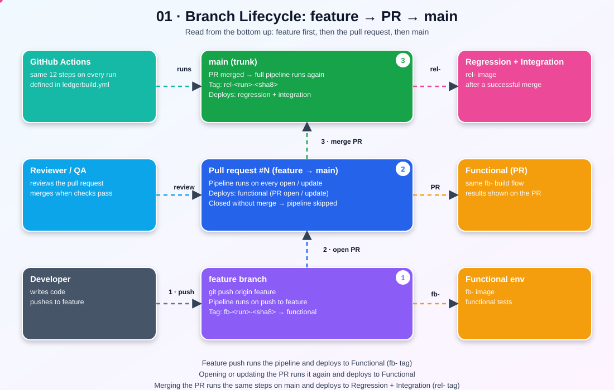

**What it shows:** how one change moves from the `feature` branch to `main`, and which environment each stage deploys to. Read it from the bottom up.

**Steps in order:**
1. **Push to `feature`** → the pipeline runs and deploys the `fb-` image to **functional**.
2. **Open or update the PR** (feature → main) → the pipeline runs again and deploys to **functional**.
3. **Merge the PR** → the pipeline runs on `main` with the same steps, builds a `rel-` image, and deploys to **regression** and **integration**. A PR closed without merging skips the pipeline.

**Tools:**
- **Git**: the branch model. `feature` is short-lived, `main` is the trunk.
- **GitHub**: hosts the repos, the pull request and the merge button.
- **GitHub Actions**: runs the pipeline on each push, PR and merge.

**Say in an interview:** this is trunk-based development. `main` is always releasable because only merged, tested code gets there.

---

### 02 · The 12-step CI/CD pipeline

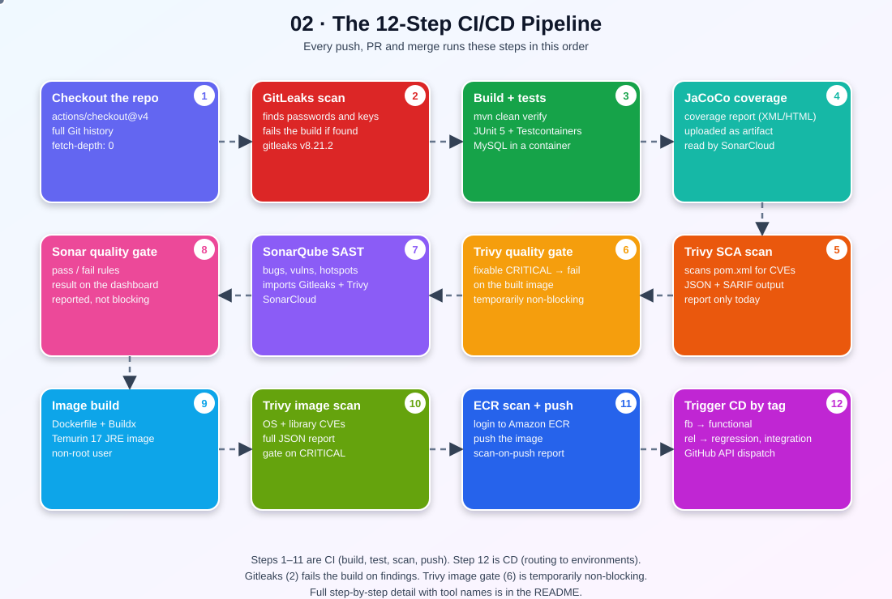

**What it shows:** all 12 steps in order, one box each, with the tool used for each.

**Steps and tools:**
1. **Checkout**: `actions/checkout@v4` downloads the code with full history.
2. **GitLeaks**: scans for secrets and fails the build if it finds any.
3. **Build and tests**: Maven runs `clean verify`. JUnit 5 runs the tests. Testcontainers starts a real MySQL for integration tests.
4. **JaCoCo**: measures test coverage and uploads the report.
5. **Trivy SCA**: checks `pom.xml` dependencies for known CVEs.
6. **Trivy gate**: fails on fixable CRITICAL CVEs in the image. Non-blocking for now.
7. **SonarQube SAST**: static analysis of the source code on SonarCloud.
8. **Sonar quality gate**: pass or fail on rules such as coverage and new issues.
9. **Image build**: Docker Buildx builds the image from the Dockerfile.
10. **Trivy image scan**: scans the image for OS and library CVEs.
11. **ECR push and scan**: logs in to Amazon ECR, pushes the image and reads the scan-on-push report.
12. **CD trigger**: starts `deploy.yml` in the deployment repo for the right environments.

**Say in an interview:** the checks run before the image is pushed. Secrets and dependencies are caught first.

---

### 03 · Steps 1–2: Checkout and GitLeaks

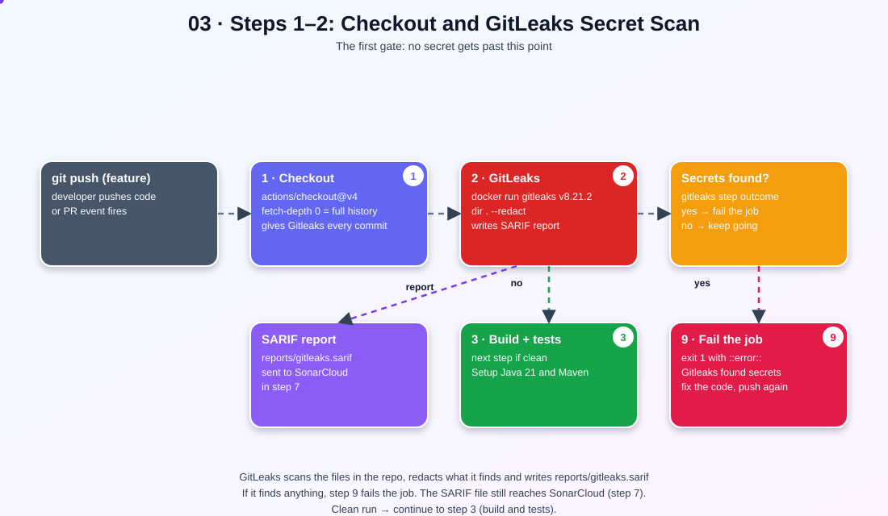

**What it shows:** the first gate. Secrets are found before any build starts.

**Steps:** push → checkout → GitLeaks scan → decision. Findings go to step 9 (fail). A clean run goes to step 3.

**Tools:**
- **`actions/checkout@v4`**: downloads the repo. `fetch-depth: 0` gets the full history, so GitLeaks sees every commit.
- **Gitleaks v8.21.2** (in Docker): `dir . --redact --report-format sarif`. It searches the files, hides the secret values in its output, and writes `reports/gitleaks.sarif`.
- **SARIF**: a standard format for security findings. SonarCloud reads it.
- **GitHub Actions `if`**: `steps.gitleaks.outcome == 'failure'` decides whether step 9 runs.

**Say in an interview:** "Gitleaks runs first, and any finding fails the build before anything is built or pushed."

---

### 04 · Step 3: Build, unit and integration tests

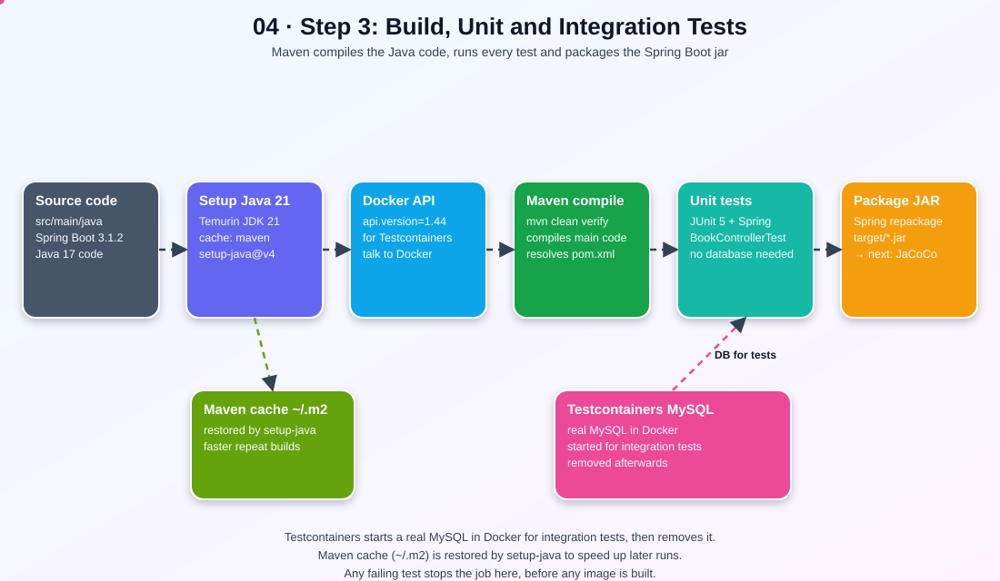

**What it shows:** the Java build, from source code to the packaged Spring Boot jar.

**Steps:** source → Java 21 setup → Docker API config → Maven compile → unit tests → package JAR. Testcontainers starts MySQL for the integration tests.

**Tools:**
- **Temurin JDK 21** (`actions/setup-java@v4`): the Java runtime for the build. The project targets Java 17, which JDK 21 compiles correctly.
- **Maven** (`mvn -B clean verify`): compiles, tests and packages. Clean removes old output, verify runs the tests and packaging.
- **JUnit 5 + Spring Boot Test**: unit tests such as `BookControllerTest`.
- **Testcontainers**: starts a real MySQL in Docker for the tests and removes it afterwards.
- **Docker API version** (`api.version=1.44`): lets Testcontainers talk to the runner's Docker.
- **Maven cache**: `setup-java` caches `~/.m2` so repeat builds are faster.

**Say in an interview:** "Integration tests run against a real MySQL in a container, not a mock, so they catch database problems."

---

### 05 · Step 4: JaCoCo code coverage

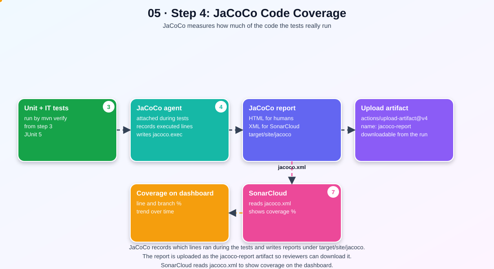

**What it shows:** how coverage is measured, reported, stored and sent to SonarCloud.

**Steps:** tests run → JaCoCo agent records executed lines → report written → uploaded as an artifact → SonarCloud reads it.

**Tools:**
- **JaCoCo**: a Java agent that records which lines the tests execute. It writes `jacoco.exec`, then HTML and XML reports under `target/site/jacoco`.
- **`actions/upload-artifact@v4`**: stores the report on the run, so it can be downloaded.
- **SonarCloud**: reads `jacoco.xml` and shows coverage on the dashboard.

**Say in an interview:** "Coverage shows which code the tests actually run, not just whether tests exist."

---

### 06 · Steps 5–6: Trivy SCA and the quality gate

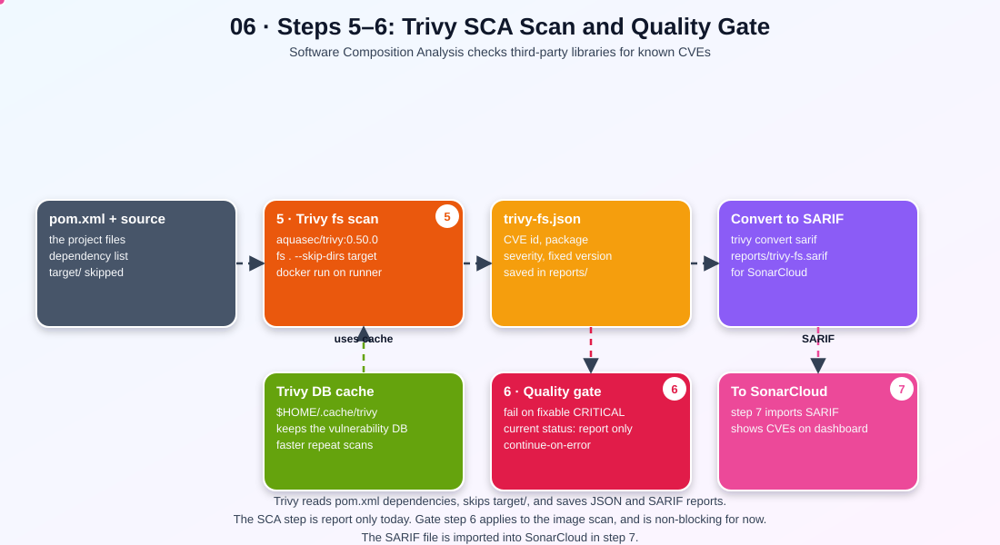

**What it shows:** how third-party libraries are checked for known CVEs (SCA), and where the Trivy gate sits.

**Steps:** `pom.xml` → Trivy filesystem scan → JSON report → SARIF conversion → SonarCloud. The gate fails on fixable CRITICAL CVEs, and is non-blocking for now.

**Tools:**
- **Trivy 0.50.0** (`aquasec/trivy`, in Docker): `fs . --skip-dirs target`. It reads `pom.xml`, looks up CVEs and skips the built jar.
- **Trivy DB cache** (`~/.cache/trivy`): keeps the vulnerability database between runs.
- **Trivy convert**: turns the JSON report into SARIF for SonarCloud.
- **Quality gate**: `--severity CRITICAL --ignore-unfixed --exit-code 1`. Only fixable CRITICAL issues count. Today it has `continue-on-error: true`.

**Honest note:** the SCA scan (step 5) is report only. The gate that can fail is on the image (step 14).

**Say in an interview:** "We check dependencies before shipping, and we only fail on fixable critical issues, so the team can act on the results."

---

### 07 · Steps 7–8: SonarQube SAST and quality gate

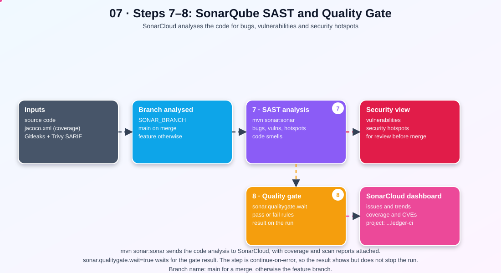

**What it shows:** the static code analysis, the quality gate, and the dashboard.

**Steps:** inputs (code, coverage, SARIF) → branch chosen → SAST analysis → quality gate → dashboard.

**Tools:**
- **SonarCloud** (`mvn sonar:sonar`): analyses the code for bugs, vulnerabilities, security hotspots and code smells.
- **Coverage input**: `sonar.coverage.jacoco.xmlReportPaths` takes the JaCoCo report.
- **SARIF input**: `sonar.sarifReportPaths` takes the Gitleaks and Trivy reports, so they show on the dashboard.
- **Quality gate**: `sonar.qualitygate.wait=true` waits for the result. The step is `continue-on-error`, so the result is reported but does not stop the run.
- **Branch**: `SONAR_BRANCH` is `main` for a merge and the feature branch otherwise.

**Say in an interview:** "SonarCloud is the single place to see bugs, security issues and coverage together."

---

### 08 · Step 9: Image build

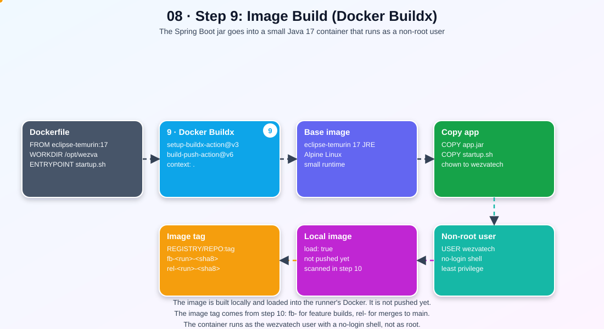

**What it shows:** how the Docker image is built, and how it runs safely.

**Steps:** Dockerfile → Buildx → base image → copy the app → non-root user → local image → tag.

**Tools:**
- **Dockerfile**: `FROM eclipse-temurin:17.0.6_10-jre-alpine`. A small Java 17 runtime on Alpine Linux.
- **Docker Buildx** (`setup-buildx-action@v3`, `build-push-action@v6`): builds the image. `load: true` keeps it on the runner, unpushed, so it can be scanned first.
- **Non-root user** (`USER wezvatech`): the container does not run as root, and its user has no login shell.
- **Labels**: the image carries the commit SHA and the actor, so it can be traced.
- **Tag**: `REGISTRY/REPO:fb-<run>-<sha8>` or `rel-<run>-<sha8>`.

**Say in an interview:** "The image is scanned before it leaves the runner, and it runs as a non-root user."

---

### 09 · Step 10: Trivy image scan

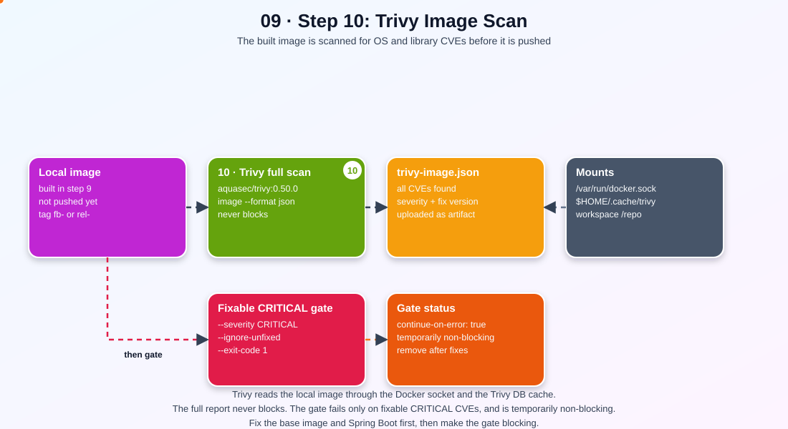

**What it shows:** the image scan that runs before the push.

**Steps:** local image → full Trivy scan (JSON, never blocks) → CRITICAL gate (non-blocking for now).

**Tools:**
- **Trivy 0.50.0 (image mode)**: scans OS packages and Java libraries inside the image.
- **Full report**: `image --format json --output reports/trivy-image.json`. It saves everything found and never fails the build.
- **Gate**: `--severity CRITICAL --ignore-unfixed --exit-code 1`. It fails only on fixable CRITICAL CVEs. `continue-on-error: true` makes it non-blocking for now.
- **Mounts**: `/var/run/docker.sock` lets Trivy read the local image. The cache folder speeds up repeat scans.

**Say in an interview:** "We keep the full list for review and only block on the critical issues that have a fix."

---

### 10 · Step 11: ECR login, push and scan report

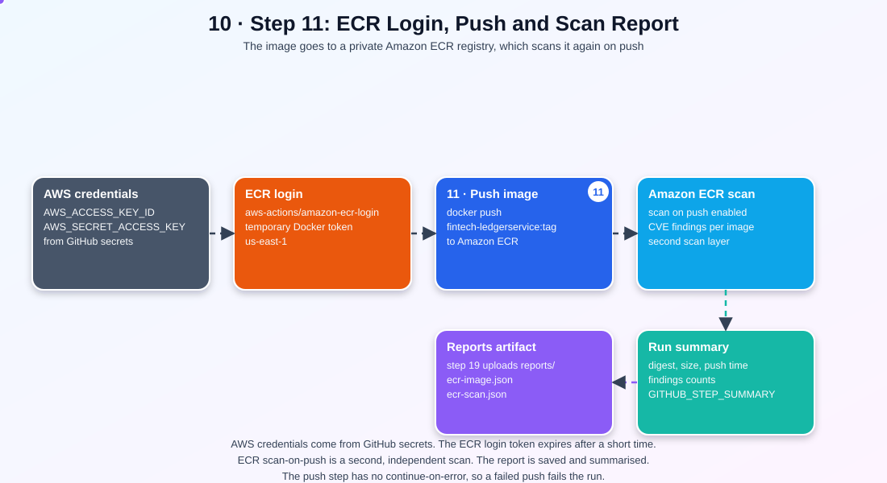

**What it shows:** how the image reaches the private registry and how ECR's own scan result is saved.

**Steps:** AWS credentials → ECR login → push → scan-on-push → summary → reports artifact.

**Tools:**
- **AWS credentials** (`aws-actions/configure-aws-credentials@v4`): logs in to AWS with `AWS_ACCESS_KEY_ID` and `AWS_SECRET_ACCESS_KEY` from GitHub secrets.
- **Amazon ECR login** (`aws-actions/amazon-ecr-login@v2`): gets a temporary Docker login token.
- **`docker push`**: sends `fintech-ledgerservice:<tag>` to ECR.
- **ECR scan-on-push**: a second, independent CVE scan run by AWS.
- **AWS CLI + jq**: `aws ecr describe-images` and `describe-image-scan-findings` save JSON, and jq writes the summary to `GITHUB_STEP_SUMMARY`.
- **`upload-artifact`** (step 19): stores the reports, even if an earlier step failed.

**Say in an interview:** "The image is scanned in two places, by Trivy in the pipeline and by ECR after the push."

---

### 11 · Step 12: Tag and event routing

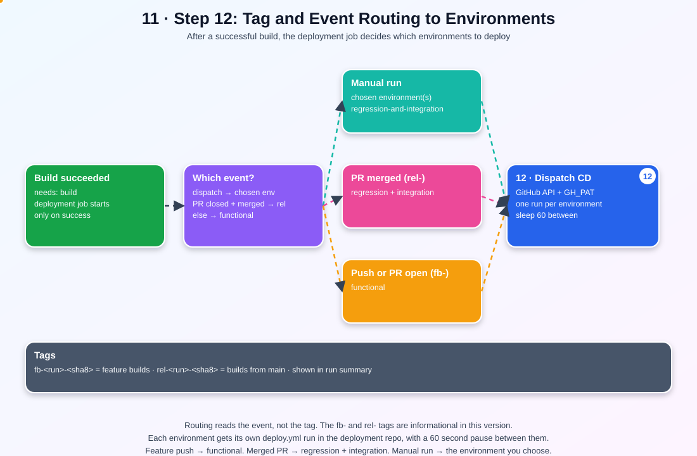

**What it shows:** how the pipeline decides which environments to deploy to.

**Steps:** build succeeded → decision on the event → one of three routes → dispatch `deploy.yml` once per environment, waiting 60 seconds between them.

**Routing rules (from the workflow):**
- Manual run: the environment you choose. `regression-and-integration` deploys both.
- PR closed and merged: **regression and integration**.
- Anything else (feature push, PR open or update): **functional**.

**Tools:**
- **GitHub REST API** (`/repos/.../actions/workflows/deploy.yml/dispatches`): starts the deployment workflow in the other repo.
- **`GH_PAT`**: a personal access token stored as a secret. It lets this repo trigger the deployment repo.
- **`sleep 60`**: gives each run time to commit before the next starts.

**Honest note:** the routing uses the **event**. The `fb-` and `rel-` tags are printed in the summary but do not drive the routing in this version.

**Say in an interview:** "Feature builds go to functional, and merged builds go to regression and integration before they are promoted."

---

### 12 · CD: Deployment repo, Argo CD and Kubernetes

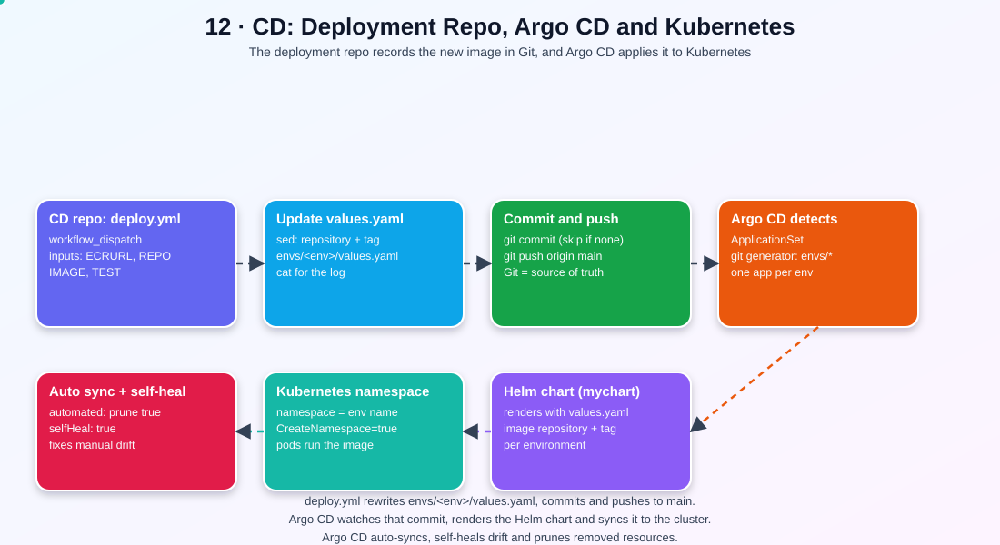

**What it shows:** how the deployment repo records the new image in Git, and how Argo CD applies it to Kubernetes.

**Steps:** `deploy.yml` → `sed` updates `values.yaml` → commit and push to `main` → Argo CD detects the commit → Helm renders the chart → Kubernetes namespace per environment → auto sync and self-heal.

**Tools:**
- **`deploy.yml`** (deployment repo): rewrites `envs/<env>/values.yaml` with `sed`, then commits and pushes.
- **Git**: the single source of truth. Every deployment is a commit.
- **Argo CD**: a GitOps controller. The **ApplicationSet** uses a git generator on `envs/*`, so each environment folder becomes one Argo CD app.
- **Helm**: the chart in `mychart` takes the values file for each environment and renders the Kubernetes manifests.
- **Kubernetes**: runs the pods. `CreateNamespace=true` creates a namespace for each environment.
- **Sync policy**: `automated` with `prune: true` and `selfHeal: true`. Removed resources are deleted, and manual drift is reverted.

**Say in an interview:** "Nobody runs `kubectl` against production. The desired state lives in Git, and Argo CD keeps the cluster matching it."

---

## 🔀 When the Pipeline Runs

| Event | CI (`build`) | CD (`deployment`) | Image tag |
|---|---|---|---|
| Push to `feature` | ✅ runs | ✅ deploys to **functional** | `fb-<run>-<sha8>` |
| Pull request opened, updated or reopened (to `main` or `feature`) | ✅ runs | ✅ deploys to **functional** | `fb-<run>-<sha8>` |
| Pull request **merged** from `feature` into `main` | ✅ runs | ✅ deploys to **regression** and **integration** | `rel-<run>-<sha8>` |
| Pull request **closed without merge** | ❌ skipped | ❌ skipped | none |
| Manual run (`workflow_dispatch`) | ✅ runs on the chosen branch | ✅ deploys to the environment you pick | `rel-` on `main`, otherwise `fb-` |

**Why the first condition works:** the `build` job has an `if:` condition. It is true for pushes, manual runs, and any pull request event except "closed without merge." A push to `feature` sets `github.event_name` to `push`, so the job always runs for pushes.

---

## 🧩 Step-by-Step Guide

The table lists every step in the order it runs. The **Phase** column matches the diagram.

### Phase 1 · Checkout and secret scan

| # | Step | What it does (plain words) | Tool |
|---|---|---|---|
| 1 | Checkout repository | Downloads the code with its full Git history (`fetch-depth: 0`) so later scans can see every commit | `actions/checkout@v4` |
| 2 | Gitleaks secret scan | Looks through the repo files for passwords, tokens and keys. Writes a SARIF report to `reports/gitleaks.sarif`. Continues even if it finds something; step 9 decides | **Gitleaks** v8.21.2 (Docker) |

### Phase 2 · Build and test

| # | Step | What it does | Tool |
|---|---|---|---|
| 3 | Setup Java 21 | Installs Temurin JDK 21 and caches Maven downloads | `actions/setup-java@v4` · **Temurin JDK** |
| 4 | Docker API version for Testcontainers | Writes `api.version=1.44` into `~/.docker-java.properties` so the Testcontainers library can talk to the runner's Docker | Shell |
| 5 | Maven build + tests (JaCoCo) | `mvn clean verify`: compiles, runs unit and integration tests (MySQL runs in a temporary container), and packages the Spring Boot JAR | **Maven**, **JUnit 5**, **Testcontainers**, **JaCoCo** |
| 6 | Upload JaCoCo report | Saves the coverage report as a downloadable artifact | `actions/upload-artifact@v4` |

### Phase 3 · Security scans

| # | Step | What it does | Tool |
|---|---|---|---|
| 7 | Trivy filesystem scan | Checks `pom.xml` dependencies for known CVEs (skips `target/`). Writes JSON and converts it to SARIF for SonarCloud | **Trivy** v0.50.0 (filesystem) |
| 8 | SonarCloud scan | Static code analysis (SAST) for bugs and security issues. Also imports the Gitleaks and Trivy SARIF reports. Waits for the **quality gate** result | **SonarCloud** (`sonar-maven-plugin`) |
| 9 | Fail if Gitleaks found secrets | If step 2 failed, this step fails the job. It runs after SonarCloud so the findings still reach the dashboard | Shell (`exit 1`) |

### Phase 4 · Build the image and scan it

| # | Step | What it does | Tool |
|---|---|---|---|
| 10 | Decide image tag | Builds the tag from the event, run number and first 8 characters of the commit SHA. `rel-` for merges to `main`, `fb-` for feature builds | Shell |
| 11 | Set up Docker Buildx | Prepares the advanced Docker builder | `docker/setup-buildx-action@v3` · **Docker Buildx** |
| 12 | Build image (local, not pushed) | Builds the image from the `Dockerfile` (Eclipse Temurin 17 JRE on Alpine, runs as a non-root user). Keeps it on the runner for scanning | `docker/build-push-action@v6` · **Docker** |
| 13 | Trivy image scan: full report | Scans the image for OS and library CVEs. Saves all findings to JSON. **Never blocks** | **Trivy** v0.50.0 (image) |
| 14 | Trivy image scan: gate | Fails on fixable **CRITICAL** CVEs. **Temporarily non-blocking** (`continue-on-error`) until the base image and Spring Boot are upgraded | **Trivy** v0.50.0 (image) |

### Phase 5 · Push to ECR and report

| # | Step | What it does | Tool |
|---|---|---|---|
| 15 | Configure AWS credentials | Logs in to AWS with the access keys from GitHub secrets, in `us-east-1` | `aws-actions/configure-aws-credentials@v4` · **AWS IAM** |
| 16 | Login to Amazon ECR | Gets a temporary Docker login token for the ECR registry | `aws-actions/amazon-ecr-login@v2` · **Amazon ECR** |
| 17 | Push image to ECR | Pushes `…/fintech-ledgerservice:<tag>` to the registry | `docker push` |
| 18 | ECR push details and scan report | Waits for ECR's **scan-on-push** result. Saves the image digest, size, push time and findings. Writes a summary on the run page | **AWS CLI**, **jq**, **Amazon ECR scanning** |
| 19 | Upload security reports | Saves every report in `reports/` as an artifact. Runs even if an earlier step failed (`if: always()`) | `actions/upload-artifact@v4` |

### Phase 6 · CD handoff (`deployment` job)

| # | Step | What it does | Tool |
|---|---|---|---|
| 20 | Trigger CD repo for each environment | Works out the target environments from the event (see the table above). For each one, calls the GitHub API to start `deploy.yml` in the deployment repo, then waits 60 seconds | **GitHub REST API**, **GitHub PAT** (`GH_PAT`), `curl` |

After step 20, the deployment repo writes the new image repo and tag into `envs/<env>/values.yaml`, commits, and pushes. **Argo CD** sees the commit and syncs the Helm chart to Kubernetes. See the deployment repo's README for details.

---

## 🛡️ DevSecOps Controls

| Control | Where | Behaviour |
|---|---|---|
| Secret detection | Step 2 + step 9 | **Blocking.** Any secret found fails the build |
| Dependency CVEs (SCA) | Step 7 | Reports only (`continue-on-error`) |
| Code quality and security (SAST) | Step 8 | **Quality gate** on SonarCloud. Step is non-blocking in the workflow, so a failed gate shows on the run but does not stop later steps |
| Image CVEs, full report | Step 13 | Reports only |
| Image CVEs, CRITICAL gate | Step 14 | **Temporarily non-blocking**. Plan: make it blocking after upgrading the base image and Spring Boot |
| ECR scan-on-push | Steps 17–18 | Second, independent scan. Results saved and summarised |
| Least privilege in the image | `Dockerfile` | Runs as a dedicated non-root user (`wezvatech`) with a no-login shell |
| Health probes | Spring Boot Actuator | `/actuator/health/liveness` and `/readiness` for Kubernetes |
| Dependency-Check (OWASP) | `pom.xml` | Configured in the pom but **skipped** in CI with `-Ddependency-check.skip=true` |

---

## 🧰 Tool Stack

| # | Tool | Category | Used in | Why it's here |
|---|---|---|---|---|
| 1 | **GitHub** (repos, PRs) | Source control | All | Code, reviews and triggers |
| 2 | **GitHub Actions** | CI orchestration | All steps | Runs the pipeline as code |
| 3 | **Gitleaks** v8.21.2 | Secret scanning | Steps 2, 9 | Stops secrets reaching `main` |
| 4 | **Temurin JDK 21** | Build runtime | Steps 3, 5 | Compiles the Java 17 project |
| 5 | **Maven** | Build tool | Step 5 | Builds, tests and packages the JAR |
| 6 | **JUnit 5** | Testing | Step 5 | Unit and integration tests |
| 7 | **Testcontainers** | Testing | Steps 4, 5 | Real MySQL in a throwaway container |
| 8 | **JaCoCo** | Code coverage | Steps 5, 6 | Shows how much code the tests cover |
| 9 | **Trivy** (filesystem) | SCA | Step 7 | Known CVEs in `pom.xml` dependencies |
| 10 | **SonarCloud** | SAST, quality gate | Step 8 | Bugs, vulnerabilities, code smells |
| 11 | **Docker** | Containers | Steps 12, 17 | Builds and pushes the image |
| 12 | **Docker Buildx** | Image builds | Step 11, 12 | Modern builder used by build-push-action |
| 13 | **Trivy** (image) | Container scan | Steps 13, 14 | CVEs inside the container image |
| 14 | **AWS IAM** (access keys) | Identity | Step 15 | Gives the runner access to AWS |
| 15 | **Amazon ECR** | Container registry | Steps 16, 17, 18 | Private image storage and scan-on-push |
| 16 | **AWS CLI** | AWS automation | Step 18 | Reads the ECR scan results |
| 17 | **jq** | JSON processing | Step 18 | Turns ECR JSON into the run summary |
| 18 | **GitHub REST API + PAT** | Cross-repo trigger | Step 20 | Starts the deployment repo's workflow |
| 19 | **Argo CD** | GitOps CD | After step 20 | Syncs Git to Kubernetes |

Plus the **Helm** chart in the deployment repo, which Argo CD renders.

**Secrets this repo needs** (GitHub → Settings → Secrets and variables → Actions): `AWS_ACCESS_KEY_ID`, `AWS_SECRET_ACCESS_KEY`, `SONARCLOUD`, `GH_PAT`.

---

## 🏗️ Application Architecture

The Ledger service is a Spring Boot REST API with three layers:

- **Controller** (`BookController`): receives HTTP requests and returns JSON.
- **Service** (`BookService`): holds the business logic.
- **Repository** (`BookRepository`): Spring Data JPA, which talks to MySQL.

Spring Boot Actuator exposes health and Prometheus metrics. The app reads its MySQL settings from `application.properties`. In the image, `startup.sh` copies in the production config and starts `app.jar`.

---

## 🚀 Run It Locally

```bash
# 1. Build the JAR and skip tests (quick local build)
mvn clean package -Dmaven.test.skip=true

# 2. Start MySQL in a container
docker run --name mydb -p 3306:3306 \
  -e MYSQL_USER=ledger -e MYSQL_PASSWORD=password \
  -e MYSQL_ROOT_PASSWORD=password -e MYSQL_DATABASE=ledgerdb \
  -d mysql:8.1

# 3. Check MySQL
docker exec -it mydb mysql -uroot -ppassword -e "show databases;"

# 4. Start the application
nohup java -jar target/*.jar > app.log 2>&1 &

# 5. Call the API
curl -s http://localhost:8080/books
curl -s -X POST -H "Content-Type: application/json" \
  -d '{"title":"Book A","price":49.99,"publishDate":"2024-04-12"}' \
  http://localhost:8080/books

# 6. Health probes
curl -s http://localhost:8080/actuator/health/liveness
curl -s http://localhost:8080/actuator/health/readiness
```

---

## 📁 Repository Layout

```
.
├── .github/workflows/ledgerbuild.yml   # the CI pipeline (20 steps, 2 jobs)
├── Dockerfile                          # Temurin 17 JRE image, non-root user
├── startup.sh                          # copies config, starts app.jar
├── pom.xml                             # Maven build, plugins, dependencies
├── src/main/java/com/mkyong/           # Spring Boot application code
├── src/test/java/com/mkyong/           # tests (JUnit 5, Testcontainers)
├── docs/diagrams/                      # diagrams used in this README
└── notes/                              # course notes
```

---

## 🎤 Interview Talking Points

- **Shift left:** secrets, dependencies and code are checked before the image is built.
- **Build once, deploy many:** one image is built per run and promoted by tag. It is not rebuilt for each environment.
- **Traceability:** each tag holds the run number and commit SHA. The image also carries the commit SHA as a label.
- **CI and CD are separate:** GitHub Actions builds and scans. Argo CD deploys from Git. Nobody changes the cluster by hand.
- **Defence in depth:** Gitleaks (secrets), Trivy (dependencies), SonarCloud (code), Trivy (image) and ECR scan-on-push each check a different layer.
- **Honest gaps:** the Trivy CRITICAL gate is non-blocking for now, the OWASP Dependency-Check is skipped, and the workflow builds with JDK 21 while the project targets Java 17. Each one is a known follow-up.
- **A lesson from a real failure:** an image push failed because the build step tried to write to the GitHub Actions cache without the right token scope. Removing the cache setting fixed it.

---

## 🧱 Branching

Trunk-based development: `main` is the trunk. Each change goes through a short-lived `feature` branch:

1. Push to `feature`. CI builds an `fb-` image and deploys to **functional**.
2. Open a PR from `feature` to `main`. CI runs on the PR.
3. Merge the PR. CI builds a `rel-` image and deploys to **regression** and **integration**.
