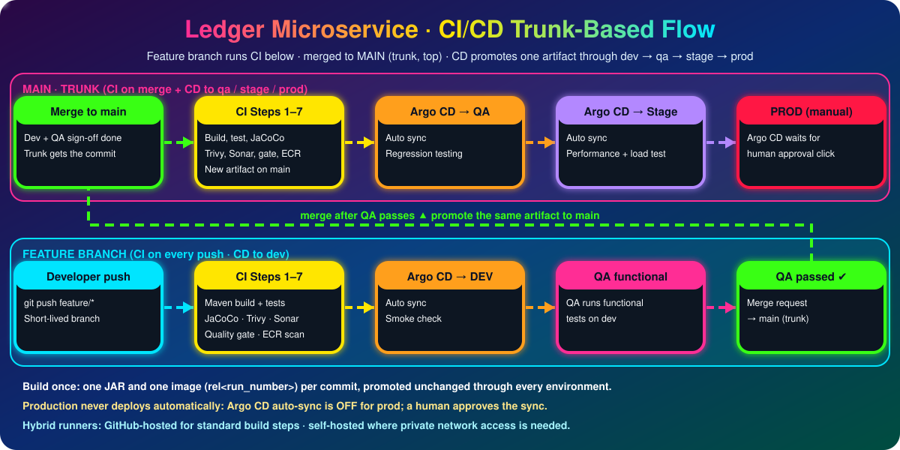
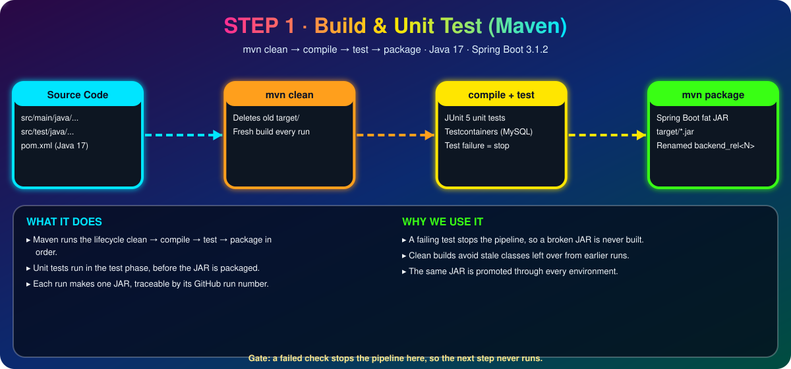
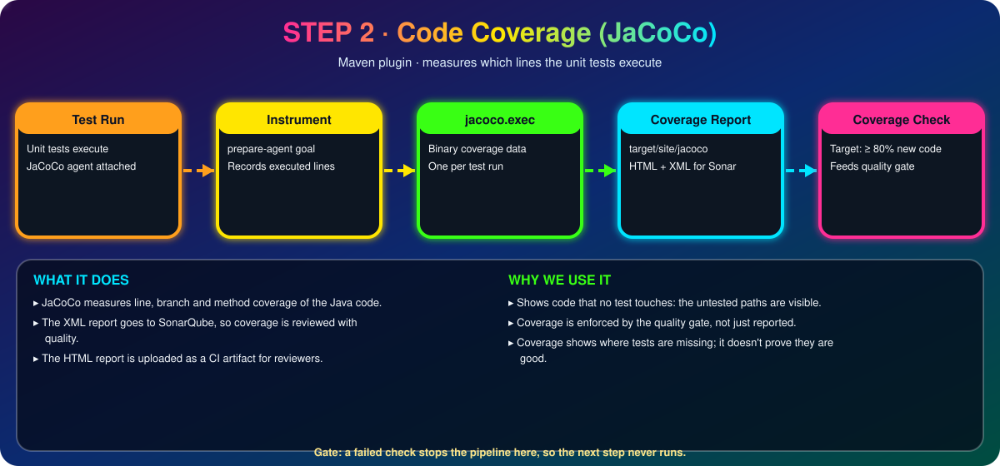
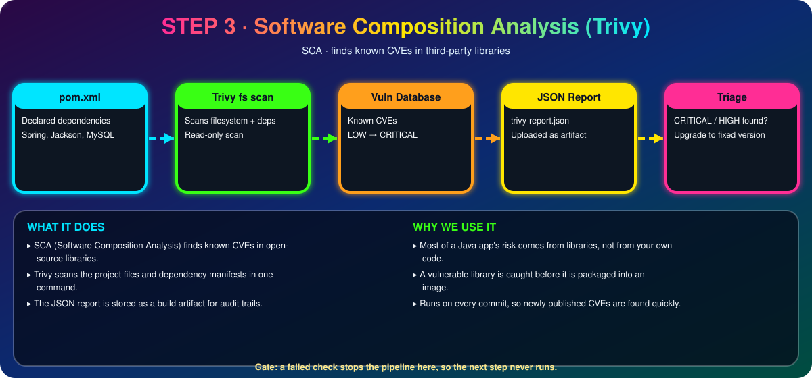
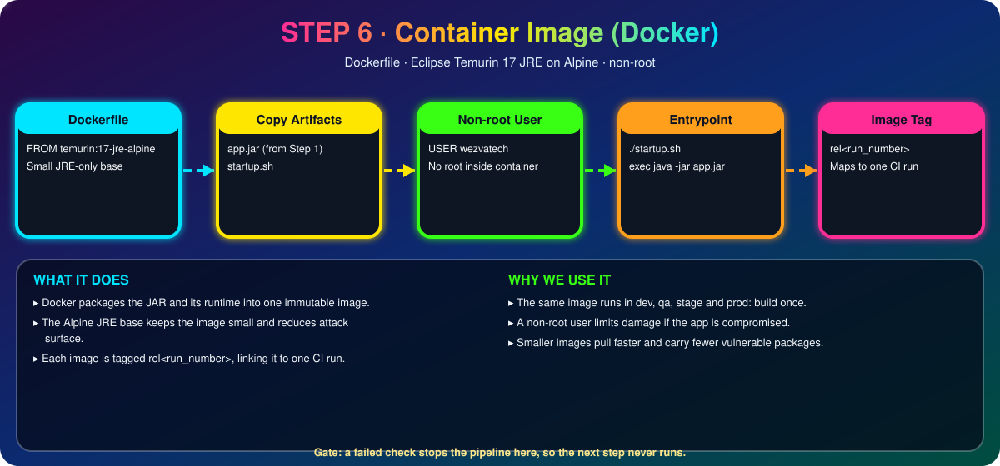

# Ledger Microservice · CI/CD with Trunk-Based Development

> A **Java 17 · Spring Boot 3.1.2 · MySQL** ledger (books) microservice built with **Maven**, delivered through **GitHub Actions** (CI) and **Argo CD** (CD) across **dev → qa → stage → prod**.

## 🗺️ Pipeline at a Glance



## 🌿 Why Trunk-Based Development?

We use **trunk-based development**: `main` is the single trunk, and every change reaches it through a **short-lived feature branch**.

- **Small, frequent merges.** Branches live for hours or a few days, not weeks, so merge conflicts stay small.
- **Always releasable trunk.** `main` holds only code that has passed CI, so any commit can become a release.
- **Fast feedback.** Each push runs the full CI pipeline, so bugs surface minutes after they are written.
- **Build once, promote everywhere.** One image per commit moves through dev, qa, stage and prod. What QA tests is what ships.
- **Simpler than long-lived branches.** No `develop` or release branches to keep in sync.

## 🔀 Branch Flow in This Repo

1. Developer creates `feature/<name>` from `main`.
2. Developer pushes to the feature branch → **CI pipeline runs** (Steps 1–7 below).
3. CI passes → the image is deployed to **dev** with Argo CD.
4. **QA runs functional tests** on dev. If they pass, the feature is merged into `main` (trunk).
5. The merge to `main` runs CI again on the trunk: build, scan and image push (Steps 1–7 again).
6. The new image is deployed to **qa** for **regression testing**, then to **stage** for **performance and load testing**.
7. **Prod** is released only after a **manual approval** in Argo CD.

## ⚙️ CI vs CD: Two Separate Pipelines

| | **CI (GitHub Actions)** | **CD (Argo CD)** |
|---|---|---|
| **Goal** | Prove the code is good and build a trusted artifact | Deploy that artifact to an environment |
| **Triggers** | Push to a feature branch, or merge to `main` | Successful CI job, which triggers the CD pipeline for the matching environment |
| **Runs** | Maven build and tests, JaCoCo, Trivy, SonarQube, quality gate, Docker build, ECR push and scan | Syncs the Kubernetes manifests in the GitOps repo to the cluster for dev, qa, stage or prod |
| **Runners** | **Hybrid:** GitHub-hosted runners for standard build steps, and self-hosted runners where a job needs private network access | Argo CD running in the cluster |

## 🧱 Build Tool: Maven

This is a Java application, so **Maven** is the build tool. `pom.xml` defines Spring Boot 3.1.2, Java 17, JUnit 5, Spring Boot Test, Testcontainers (MySQL), the JaCoCo plugin and the Sonar plugin. Maven runs the lifecycle in order: `clean` → `compile` → `test` → `package`.

## 🔁 The 7 CI Steps (Feature Branch and Main)

Every CI run builds a new artifact, so the same steps run on the feature branch and again on `main`.

### Step 1 · Build the artifact (Maven: clean, unit test, package)


- **`mvn clean package`** removes old output, compiles the code, runs the **unit tests** and packages the Spring Boot JAR.
- **Unit tests** use **JUnit 5** and Spring Boot Test. Controller tests such as `BookControllerTest` run without a real database.
- Tests run in the Maven `test` phase, **before** `package`. A failing test stops the pipeline, so no broken JAR is built.
- The JAR is renamed to `backend_rel<run_number>.jar` so each build is traceable.

### Step 2 · Code coverage (JaCoCo)


- **JaCoCo** is a Maven plugin that measures how much of the code the unit tests exercise (line, branch and method coverage).
- It writes an HTML and XML report to `target/site/jacoco`. The report is uploaded as a build artifact and passed to SonarQube.
- Coverage alone doesn't prove the tests are useful, but a low number shows code that is never tested.

### Step 3 · Software Composition Analysis (Trivy SCA)


- **SCA** checks the open-source libraries in the project (Spring, Jackson, MySQL driver and so on) for **known CVEs**.
- **Trivy** scans the project filesystem and `pom.xml` and writes a JSON report, which is uploaded as an artifact.
- This catches a vulnerable dependency before it gets into an image.

### Step 4 · Static Application Security Testing (SonarQube)


- **SAST** reads the source code without running it and reports bugs, security vulnerabilities, security hotspots and code smells.
- SonarQube receives the JaCoCo report, so coverage and quality are reviewed together.
- The project key and branch name are sent with each run, so feature and main results are reported separately.
- *Note:* the current workflow sends results to **SonarCloud**, the hosted SonarQube service.

### Step 5 · Quality Gate


- The **quality gate** is a set of pass/fail rules applied to the SonarQube analysis, for example:
  - coverage on new code at least **80%**
  - no new **blocker or critical** issues
  - duplicated code on new code at most **3%**
- The pipeline waits for the gate result with `-Dsonar.qualitygate.wait=true`. A failed gate **fails the job**, so the code can't move on.
- *Note:* the current workflow still has `continue-on-error` on the Sonar and image-scan steps. Those should be removed so the gates block the pipeline.

### Step 6 · Container image (Docker)


- The `Dockerfile` builds from **`eclipse-temurin:17` JRE on Alpine**: a small, Java 17 runtime image.
- The app runs as a **non-root user** (`wezvatech`), not root.
- `startup.sh` writes the environment's configuration file and starts `java -jar app.jar`.
- The image is tagged **`rel<run_number>`**, so each image maps to one CI run.

### Step 7 · Image push and scan (Amazon ECR)


- The image is pushed to **Amazon ECR** (Elastic Container Registry).
- **ECR scanning** checks the image's operating-system and application packages for vulnerabilities. Basic scanning is based on **Clair**, an open-source vulnerability scanner.
- The pipeline reads the findings (`describe-image-scan-findings`) and counts CRITICAL and HIGH issues. Those counts are the input to the security gate.
- Enable **scan-on-push** on the repository so every image is checked automatically.

## 🧰 Tool Stack

Every tool used in this pipeline, what it does here, and where it sits.


## 🚀 CD: Deploy with Argo CD

- When the CI job succeeds, it **triggers the CD pipeline** for the environment the artifact is going to. The CI job starts the deployment with the `rel<run_number>` image tag.
- **Argo CD** is a GitOps controller. It watches the Git repository that holds the Kubernetes manifests and makes the cluster match what is in Git.
- The image tag is updated in Git for the target environment, and Argo CD syncs it.

| Environment | Trigger | Argo CD sync | Tests |
|---|---|---|---|
| **dev** | CI passes on feature branch | Automatic | Smoke test |
| **qa** | Merge to `main` (after QA's functional sign-off on dev) | Automatic | **Regression** testing |
| **stage** | QA regression passes | Automatic | **Performance and load** testing |
| **prod** | Stage performance and load pass | **Manual**, with human approval | Release |

**Production is never automatic.** Auto-sync is off for prod, so an engineer must review and approve the sync in Argo CD.

## 🧪 Local Run (Existing Instructions)

The original run instructions are kept below.

# Spring Boot + MySQL example - WEZVA TECHNOLOGIES | ADAM | 9739110917
# Sample commit - 04

## Technologies used:
* Spring Boot 3.1.2
* MySQL 8
* Java 17
* Maven 3
* JUnit 5
* Docker

## How to run it
```
# Build Jar & Skip Unit Test
$ mvn clean package -Dmaven.test.skip=true

# Run MySQL backend container for testing
$ docker run --name mydb -p 3306:3306 -e MYSQL_USER=wezvatech -e MYSQL_PASSWORD=password -e MYSQL_ROOT_PASSWORD=password -e MYSQL_DATABASE=mywezvadb -d mysql:8.1

# Check if mysql is working fine
$ docker exec -it mydb mysql -uroot -ppassword
  mysql> show databases;
  mysql> use mywezvadb;
  mysql> show tables;
  mysql> select * from books;

# Deploy the application
$ nohup java -jar target/wezvatech-springboot-mysql-9739110917.jar 2>&1 &

# Check if its up & running
$ curl -s http://localhost:8080/books

# Add a entry to test the application
$ curl -X POST -H "Content-Type: application/json" -d '{"title":"Book A", "price":49.99, "publishDate":"2024-04-12"}' "http://localhost:8080/books"

# Healcheck Probes
$ curl -s http://localhost:8080/actuator/health/liveness
$ curl -s http://localhost:8080/actuator/health/readiness

# dummy commit Apr/12
#test
```
